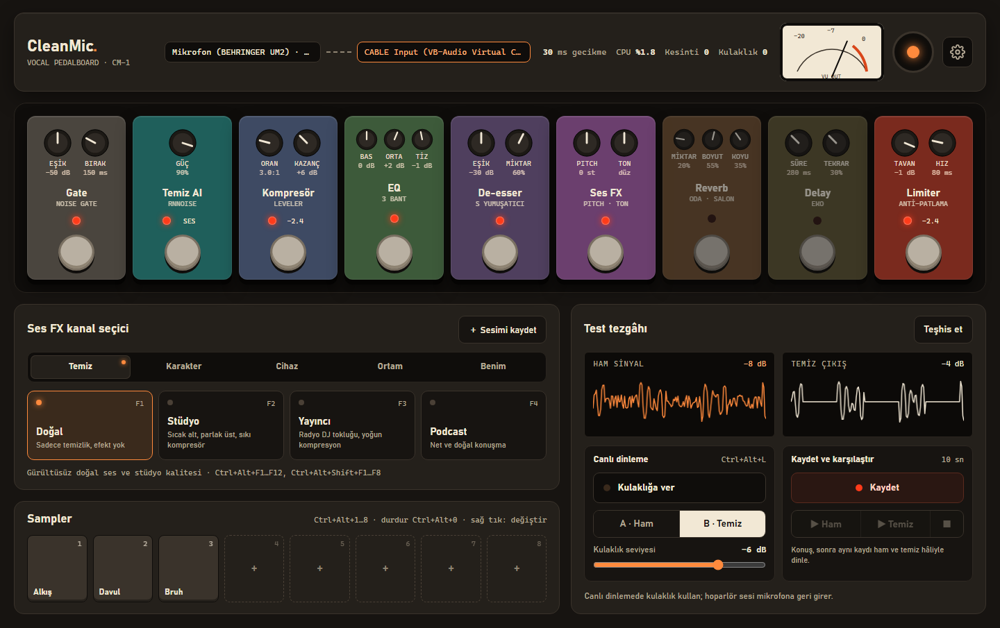
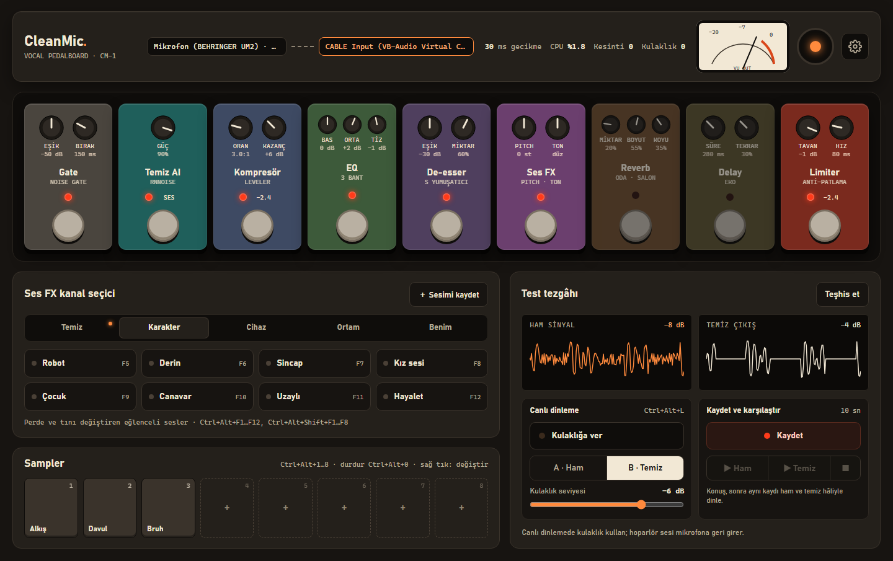
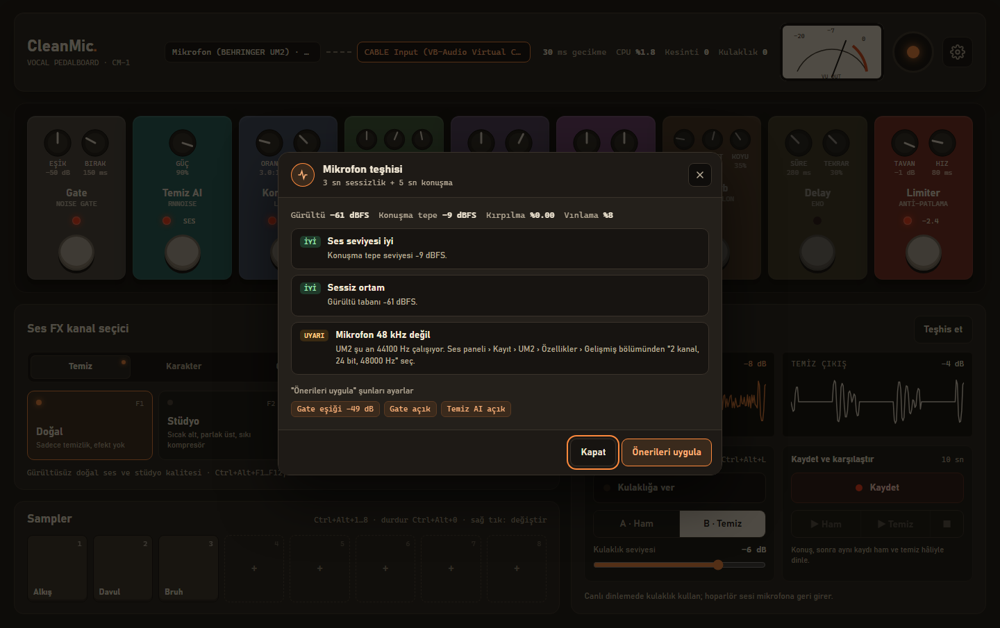
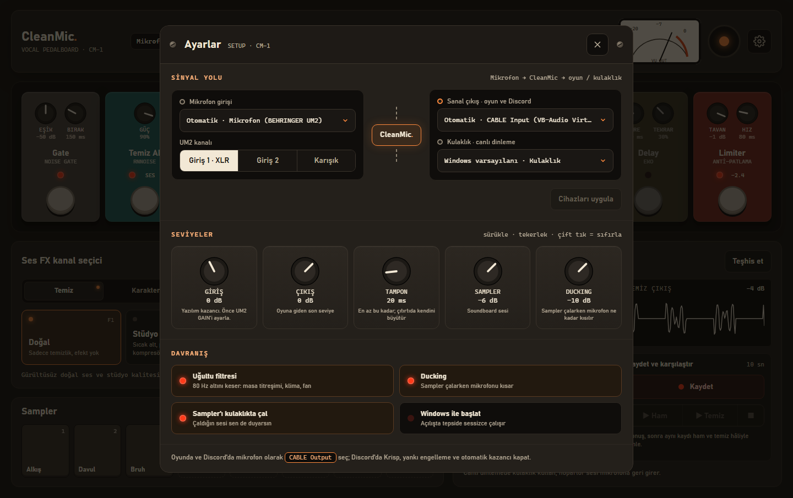

# CleanMic

**Windows için gerçek zamanlı mikrofon temizleyici ve ses efekti pedalboard'u.**

Discord'un kendi gürültü engeli sayesinde orada temiz duyulan ama oyunlarda cızırtılı ve uğultulu
gelen mikrofon sesi için yazıldı. CleanMic mikrofonunu dinler, gürültüyü yapay zekâ ile siler,
seviyeyi dengeler, istersen efekt ekler ve sonucu **sanal bir mikrofona** verir. Oyunda ve
Discord'da bu sanal mikrofonu (`CABLE Output`) seçmen yeterli.

Behringer UM2 + C-1 condenser mikrofon ile geliştirildi; her Windows (WASAPI) mikrofonuyla çalışır.



---

## İçindekiler

- [Nasıl çalışır](#nasıl-çalışır)
- [Kurulum](#kurulum)
- [Pedallar](#pedallar)
- [Ses modları](#ses-modları)
- [Test tezgâhı ve teşhis](#test-tezgâhı-ve-teşhis)
- [Sampler](#sampler)
- [Ayarlar](#ayarlar)
- [Kısayollar](#kısayollar)
- [Cızırtı ve patlamaya karşı alınan önlemler](#cızırtı-ve-patlamaya-karşı-alınan-önlemler)
- [Sorun giderme](#sorun-giderme)
- [Geliştirme](#geliştirme)

---

## Nasıl çalışır

```
 C-1 mikrofon ─► UM2 ─► CleanMic ─► CABLE Input ══ VB-Cable ══► CABLE Output ─► Oyun / Discord
                           │
                           └──────► Kulaklık (canlı dinleme, isteğe bağlı)
```

CleanMic ses kartından gelen sesi 10 ms'lik bloklar hâlinde işler:

`giriş kazancı → 80 Hz uğultu filtresi → RNNoise (AI) → Gate → Kompresör → EQ → De-esser → Ses FX → Reverb → Delay → (+ sampler) → çıkış kazancı → Limiter`

Toplam gecikme genelde **25–40 ms** arasındadır; konuşmada fark edilmez.

## Kurulum

1. **VB-Audio Virtual Cable**'ı kur: <https://vb-audio.com/Cable/>
   Zip'i çıkar, `VBCABLE_Setup_x64.exe` → sağ tık → **Yönetici olarak çalıştır** → *Install Driver*.
   Ardından **bilgisayarı yeniden başlat**.
2. **CleanMic**'i kur: [Releases](https://github.com/YusufEsan/cleanMic/releases) sayfasından
   `CleanMic_x.y.z_x64-setup.exe` dosyasını indirip çalıştır. Türkçe kurulum sihirbazı yönetici
   izni istemez; Başlat menüsüne ekler, isteğe bağlı masaüstü kısayolu oluşturur ve bitince uygulamayı
   başlatabilir. VB-Cable kurulu değilse kurulumun sonunda uyarıp indirme sayfasını açmayı teklif eder.
   Kaldırmak için: *Ayarlar › Uygulamalar › CleanMic › Kaldır*.
3. **Oyunda ve Discord'da** mikrofon olarak **CABLE Output (VB-Audio Virtual Cable)** seç.
   Hoparlör olarak kulaklığını bırak; **asla CABLE Input seçme**, yoksa karşı taraf kendini duyar.
4. **Discord'da** *Gürültü engelleme (Krisp)*, *Yankı engelleme* ve *Otomatik kazanç kontrolü*nü kapat.
   CleanMic bu işleri zaten yapıyor; üst üste binince ses robotik ve kesik gelir.
5. Uygulamada **Teşhis et**'e bas: 3 sn sessiz kal, 5 sn konuş. Uygulama sorunları listeler ve
   tek tıkla uygulanabilen ayar önerileri verir.

> Pencereyi kapatınca uygulama **tepsiye küçülür** ve çalışmaya devam eder. Tamamen kapatmak için
> tepsi simgesine sağ tıkla → *Çıkış*.

## Pedallar

Her pedalın altındaki büyük düğme pedalı açar/kapatır; LED yanıyorsa pedal aktiftir.
Düğmeleri **yukarı/aşağı sürükleyerek** çevir (Shift = ince ayar), **fare tekerleği** de çalışır,
**çift tık** varsayılana döndürür.

| Pedal | Ne yapar | Düğmeler |
| --- | --- | --- |
| **Gate** | Konuşmadığında mikrofonu tamamen susturur. RNNoise'un ses algılamasına bağlıdır: cümle bitince 25 ms'de kapanır, kelime aralarında yumuşak kalır. | Eşik, bırakma süresi |
| **Temiz AI** | RNNoise yapay zekâsıyla fan, klavye, oda uğultusu ve cızırtıyı siler. "SES" ışığı konuştuğunu algıladığını gösterir. | Güç |
| **Kompresör** | Fısıltı ile bağırış arasındaki farkı azaltır, sesi toparlar. | Oran, kazanç |
| **EQ** | 3 bant ton ayarı: bas (150 Hz), orta (1.5 kHz), tiz (6 kHz). | Bas, orta, tiz |
| **De-esser** | Condenser mikrofonun keskin "s/ş" seslerini yumuşatır. | Eşik, miktar |
| **Ses FX** | Seçili ses modunu uygular (perde, ton, distorsiyon, filtre…). | Pitch, ton |
| **Reverb** | Oda, salon, mağara yankısı. Boyut küçük odadan katedrale kadar; koyuluk taş/cam (parlak) ile halı/su (boğuk) arasında. | Miktar, boyut, koyuluk |
| **Delay** | Eko. | Süre, tekrar |
| **Limiter** | Sesin tavanı asla aşmasını engeller; bağırınca **patlama olmaz**. | Tavan, hız |

## Ses modları



Modlar 5 sekmede toplanır. Bir moda tıkla ya da kısayolunu kullan; sonra **Ses FX** pedalındaki
PITCH ve TON düğmeleriyle ince ayar yap.

| Sekme | Modlar |
| --- | --- |
| **Temiz** | Doğal · **Stüdyo** (sıcak alt, parlak "hava", sıkı kompresör, 25 ms ön gecikmeli ince plate reverb) · **Yayıncı** (radyo DJ tokluğu) · **Podcast** (net, doğal, kuru) |
| **Karakter** | Robot · Derin · Sincap · Kız sesi · Çocuk · Canavar · Uzaylı · Hayalet |
| **Cihaz** | Radyo (eski AM) · Telefon · Telsiz · Megafon |
| **Ortam** | **Mağara** (uzun, koyu taş yankı + slapback) · **Stadyum** (yankı uzak tribünden 90 ms sonra döner) · **Su altı** (kısa, çok boğuk, dalgalı) · **8-bit** |
| **Benim** | Kendi kaydettiğin modlar |

**Kendi modunu kaydetmek:** Pedalları istediğin gibi ayarla → **＋ Sesimi kaydet** → isim ver.
Kayıtlı bir modun **⋯** menüsünden (ya da sağ tıkla) *Uygula*, *Şu anki sesle güncelle*,
*Yeniden adlandır* ve *Sil* işlemleri yapılır. En fazla 12 kayıtlı mod tutulur.

> Stüdyo/Yayıncı/Podcast modları EQ ve kompresör ayarlarını, Mağara/Hayalet/Stadyum/Su altı modları
> reverb ve delay'i kendileri açar. Başka bir moda geçince bu ayarlar geri alınır; senin elle açtığın
> pedallara dokunulmaz.

## Test tezgâhı ve teşhis

- **Ham sinyal / Temiz çıkış:** mikrofondan gelen ham ses ile oyuna giden temiz sesin canlı dalga
  formları ve seviyeleri. Sessizken temiz tarafın düz çizgi olması gerekir.
- **Canlı dinleme:** işlenmiş sesi kulaklıktan anlık duyarsın. **A · Ham / B · Temiz** anahtarıyla
  farkı karşılaştır. *Hoparlörle değil kulaklıkla kullan*, yoksa ses mikrofona geri girer.
- **Kaydet ve karşılaştır:** 10 saniye konuş, aynı kaydı önce ham sonra temiz hâliyle dinle.
  Canlı dinlemedeki gecikme olmadığı için fark daha net duyulur.



**Teşhis et** şunları ölçer ve açıklar:

| Bulgu | Anlamı / çözümü |
| --- | --- |
| Sinyal doyuyor (clipping) | Cızırtının en sık sebebi. UM2'deki **GAIN** düğmesini kıs; konuşurken kırmızı CLIP ışığı yanmamalı. |
| Neredeyse sinyal yok | C-1 condenser mikrofon **+48V phantom** olmadan çalışmaz; UM2'deki +48V düğmesini aç. |
| Ses seviyesi düşük | Önce donanımdan (GAIN) aç; yazılım kazancı gürültüyü de büyütür. |
| Ortam gürültüsü yüksek | Fan/klima/bilgisayar yakınlığı. Temiz AI bunu büyük ölçüde siler. |
| Elektrik vınlaması (50 Hz) | USB'yi başka porta (arka panel) tak, şarj aletlerini uzaklaştır, topraklı priz kullan. |
| Mikrofon / VB-Cable 48 kHz değil | Windows Ses paneli › cihaz › Özellikler › Gelişmiş › **48000 Hz** seç. |
| Tampon boşaldı | Ayarlar › Tampon değerini artır. |

**Önerileri uygula** gate eşiğini ölçülen gürültüye göre ayarlar, gerekirse kazancı ve tamponu da düzeltir.

## Sampler

8 pad'e ses dosyası (WAV, MP3, OGG, FLAC, M4A/AAC, AIFF) yükleyip kısayolla çal. Sesler sanal
mikrofona gider, yani oyundaki/Discord'daki herkes duyar.

- Boş pad'e tıkla → dosya seç. Dolu pad'e **sağ tık** → çal, dosyayı değiştir, tümünü durdur, temizle.
- **Ducking:** sampler çalarken mikrofonun otomatik kısılır (Ayarlar'dan miktarı ayarlanır).
- **Kulaklıkta da çal:** çaldığın sesi sen de duyarsın.
- Tüm sesler otomatik olarak aynı yüksekliğe getirilir ve limiter'dan geçer.

## Ayarlar



- **Sinyal yolu:** mikrofon girişi, UM2 kanalı (Giriş 1 XLR / Giriş 2 / karışık), sanal çıkış ve
  kulaklık cihazı. "Otomatik" UM2'yi ve CABLE Input'u kendisi bulur.
- **Seviyeler:** giriş/çıkış kazancı, tampon, sampler seviyesi, ducking miktarı.
- **Davranış:** uğultu filtresi, ducking, sampler'ı kulaklıkta çalma, Windows ile başlatma.

Ayarlar otomatik kaydedilir: `%APPDATA%\com.cleanmic.app\settings.json`.

## Kısayollar

Kısayollar oyun içindeyken de çalışır (global).

| Kısayol | İşlev |
| --- | --- |
| `Ctrl+Alt+M` | Mikrofonu sustur / aç |
| `Ctrl+Alt+F1 … F12` | Ses modları 1–12 |
| `Ctrl+Alt+Shift+F1 … F8` | Ses modları 13–20 |
| `Ctrl+Alt+1 … 8` | Sampler pad'leri |
| `Ctrl+Alt+0` | Sampler'ı durdur |
| `Ctrl+Alt+L` | Canlı dinlemeyi aç / kapa |
| `Ctrl+Alt+B` | Ses FX pedalını aç / kapa |

## Cızırtı ve patlamaya karşı alınan önlemler

- **Saat kayması telafisi:** ses kartı ile VB-Cable'ın saatleri birbirinden çok az farklıdır. CleanMic
  okuma hızını ±%0.5 içinde, duyulmayacak şekilde ayarlar; tampon ne boşalır ne taşar.
- **Kendini ayarlayan tampon:** sürücü sesi büyük parçalarla isterse tampon kendiliğinden büyür,
  uzun süre sorun olmazsa gecikmeyi azaltmak için yavaşça küçülür.
- **Yumuşak geçişler:** kesinti olursa ses sertçe kesilmez, sönerek susar ve yumuşakça geri gelir.
  Pedal açma/kapama, sessize alma ve mod geçişleri de tıklamasızdır.
- **İleri bakışlı limiter:** 2 ms önceden bakarak tepe değerleri yakalar; dijital kırpma olmaz.
- **Konuşma sonu kuyruğu yok:** cümle bitince RNNoise'un sönen kalıntısı kompresörle yükseltilip
  "pşşt" gibi duyulmasın diye gate yapay zekânın ses algılamasıyla 25 ms'de kapanır, kompresör de
  -55 dB altını yükseltmek yerine kısar. Bu davranış otomatik testle korunur.
- **Pro Audio önceliği:** ses thread'leri Windows MMCSS "Pro Audio" sınıfında çalışır; oyun CPU'yu
  doldursa bile ses zamanında işlenir.
- Üst barda **Kesinti** (oyuna giden çıkış) ve **Kulaklık** sayaçları gerçek kesinti sayısını gösterir.

## Sorun giderme

| Belirti | Çözüm |
| --- | --- |
| "VB-Cable bulunamadı" | VB-Cable'ı yönetici olarak kurup bilgisayarı yeniden başlat. Aygıt Yöneticisi'nde hata varsa eski sürümü kaldırıp güncelini kur. |
| Oyunda sesim gelmiyor | Oyunun mikrofon ayarında **CABLE Output** seçili mi? Seçim yoksa Windows › Ses › Kayıt'ta CABLE Output'u varsayılan yap. |
| Ses robotik / kesik | Discord'da Krisp, yankı engelleme ve otomatik kazancı kapat. |
| Ara ara çıtırtı | **Kesinti** sayacı artıyorsa Ayarlar › Tampon'u 30–40 ms yap. Teşhis'i çalıştır. |
| Sesim çok kısık | Önce UM2 GAIN düğmesini aç, sonra Kompresör KAZANÇ ya da Ayarlar › Çıkış kazancı. |
| Kendi sesimi yankı olarak duyuyorum | Canlı dinleme açık ve hoparlör kullanıyorsun; kulaklık tak ya da canlı dinlemeyi kapat. |

## Geliştirme

Teknolojiler: **Tauri 2** (Rust + WebView2), ses için **cpal** (WASAPI), gürültü için **nnnoiseless**
(RNNoise'un Rust portu), dosya çözümleme için **symphonia**. Arayüz derleme adımı olmayan düz
HTML/CSS/JS'tir.

Gerekenler: Rust (MSVC toolchain; `rust-toolchain.toml` otomatik seçer), Node.js, WebView2.

```powershell
npm install
npm run dev      # geliştirme (değişince yeniden derler)
npm run build    # src-tauri\target\release\bundle\nsis\CleanMic_x.y.z_x64-setup.exe
cd src-tauri; cargo test --release   # ses zinciri testleri (konuşma sonu kuyruğu, mekân reverb'leri)
```

Sürüm geçmişi: [CHANGELOG.md](CHANGELOG.md)

```
src-tauri/src/
  main.rs      uygulama durumu, komutlar, kısayollar, tepsi, metre/kaydetme thread'leri
  engine.rs    cihazlar, giriş/çıkış stream'leri, drift telafisi, kendini ayarlayan tampon
  chain.rs     işleme zinciri (10 ms bloklar)
  dsp.rs       efekt blokları: biquad, gate, kompresör, pitch, reverb, delay, limiter, de-esser
  settings.rs  parametreler, 20 ses modu, kullanıcı modları
  diag.rs      teşhis analizi, osiloskop verisi
  sound.rs     sampler dosyalarını 48 kHz mono'ya çözme
ui/            arayüz (index.html, style.css, app.js)
docs/          ekran görüntüleri
```

Arayüzü tarayıcıda (Tauri olmadan, sahte verilerle) önizlemek için `ui/index.html`'i bir statik
sunucuyla aç; `?shot=settings`, `?shot=diag`, `?shot=char` parametreleri ilgili ekranı açar.
